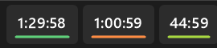
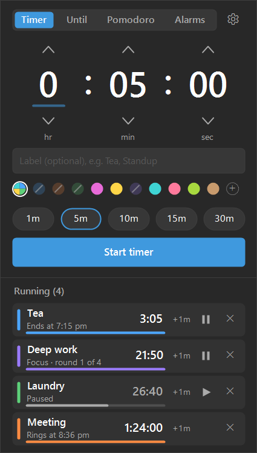
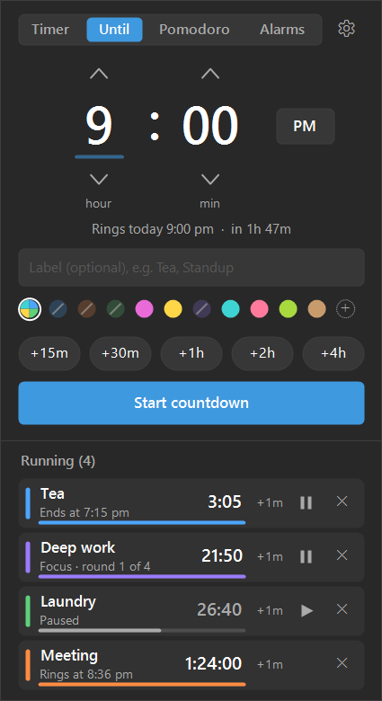
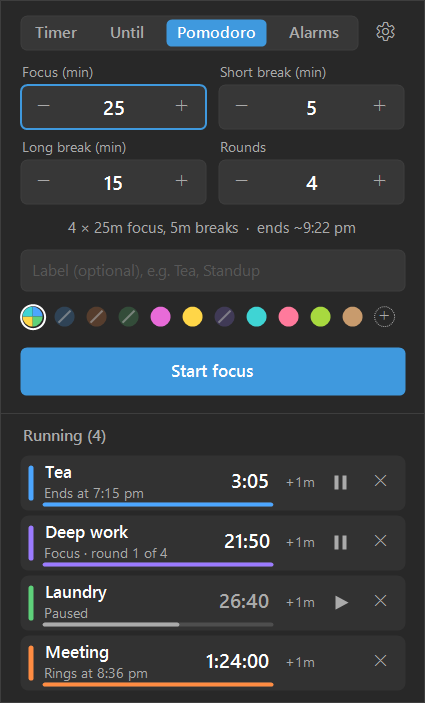
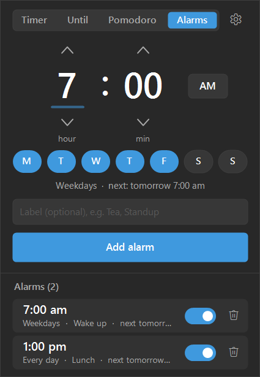
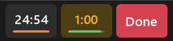
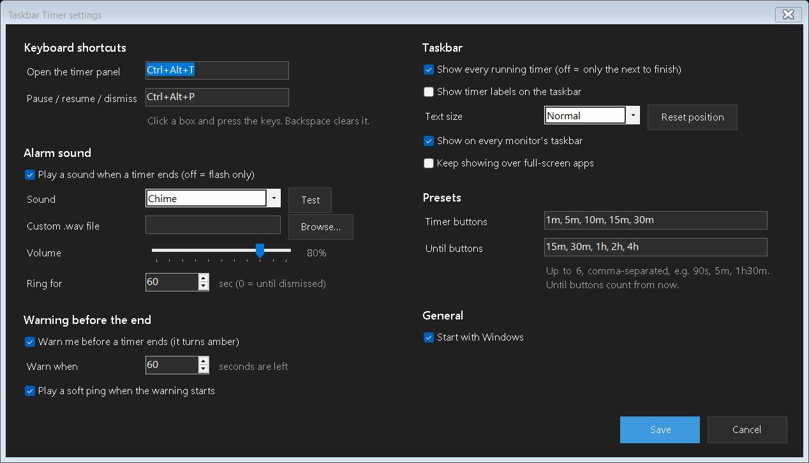

# Taskbar Timer

A lightweight countdown timer for Windows 11 that lives **in the taskbar**. Running timers appear as small live countdowns right next to the system tray, so you can always see how much time is left without opening anything.



> [!IMPORTANT]
> **AI-generated project.** This entire project was written by **Claude**, an AI model made by [Anthropic](https://www.anthropic.com). That includes the source code, build script, screenshots and this README. It was built through a conversation in [Claude Code](https://claude.com/claude-code), with the repository owner describing the features they wanted and testing the results.
>
> The code was checked during development: it compiles, it runs on a real Windows 11 desktop, and its timer, alarm and Pomodoro logic were exercised by small test scripts. But it has **not** been through a formal code review or broad testing on many machines. It is provided **as is, without warranty of any kind**. Read the code before you rely on it, and please don't depend on it for anything critical, such as medication reminders or safety alarms.

---

## Contents

- [Features](#features)
- [Screenshots](#screenshots)
- [Requirements](#requirements)
- [Building and running](#building-and-running)
- [How to use it](#how-to-use-it)
- [Settings](#settings)
- [Command-line options](#command-line-options)
- [How it works](#how-it-works)
- [Where your data is stored](#where-your-data-is-stored)
- [Known limitations](#known-limitations)
- [Uninstalling](#uninstalling)

---

## Features

| | |
|---|---|
| **Live taskbar countdown** | Every running timer shows as a pill on the taskbar, just left of the tray icons, with a progress bar underneath. |
| **Several timers at once** | Run up to 10 timers side by side. The one that ends soonest sits nearest the tray. |
| **A colour per timer** | Each timer gets its own progress colour. Pick one of 10 preset colours, choose any custom colour, or leave it on random. No two running timers ever share a colour. |
| **Labels** | Name a timer ("Tea", "Standup"). The name shows in the panel, the notification and the hover tooltip, and optionally on the taskbar. |
| **Four modes** | **Timer** (a duration), **Until** (count down to a clock time), **Pomodoro** (focus and break cycles) and **Alarms** (repeating alarms on chosen days). |
| **Type or click** | Type a time straight into the panel (`2` `5` Enter starts 25 minutes), or use the ▲/▼ arrows and the mouse wheel. |
| **Hours shown when needed** | Durations of an hour or more show as `h:mm:ss`. Timers can be up to 23:59:59. |
| **Early warning** | When a timer is about to end (60 seconds by default), it turns amber and plays a soft ping. |
| **Proper alarm** | When a timer ends, its pill flashes red, a Windows notification appears and an alarm sound plays. |
| **Sound choices** | Four built-in sounds (generated in code, so there are no audio files) or your own `.wav` file, with volume, ring length and a silent "flash only" mode. |
| **Global hotkeys** | `Ctrl+Alt+T` opens the panel from anywhere. `Ctrl+Alt+P` pauses or resumes everything, or silences a ringing alarm. You can change both. |
| **Custom presets** | Choose your own quick-pick buttons (e.g. `90s, 5m, 1h30m`). |
| **Every monitor** | Countdowns can appear on the taskbar of every monitor. |
| **Theme aware** | Follows Windows light/dark mode and your accent colour. |
| **Tiny and dependency-free** | One small `.exe`. Nothing to install: it builds with the C# compiler that already ships with Windows. |

---

## Screenshots

**The timer panel.** Click the tray icon or a taskbar pill to open it. The top half starts a new timer, and the bottom half lists everything that's running.

| Timer | Until | Pomodoro | Alarms |
|---|---|---|---|
|  |  |  |  |

**On the taskbar.** A timer near the end turns amber; a finished one flashes red with "Done".



**Settings**



---

## Requirements

- **Windows 11.** Windows 10 should mostly work, but the taskbar placement was designed and tested on Windows 11.
- **.NET Framework 4.x.** This is built into Windows 10 and 11, so there's nothing to install.
- The taskbar must be **horizontal** (the Windows 11 default).

---

## Building and running

There's no installer. You compile one file with the C# compiler included in Windows.

1. Download or clone this repository.
   ```powershell
   git clone https://github.com/<your-username>/<this-repo>.git
   cd <this-repo>
   ```
2. Build it by double-clicking **`build.cmd`**, or run:
   ```powershell
   .\build.cmd
   ```
   This creates `TaskbarTimer.exe` next to the source file. It runs:
   ```
   %WINDIR%\Microsoft.NET\Framework64\v4.0.30319\csc.exe /codepage:65001 /target:winexe /optimize+
       /out:TaskbarTimer.exe /r:System.Windows.Forms.dll /r:System.Drawing.dll TaskbarTimer.cs
   ```
3. Run **`TaskbarTimer.exe`**. A stopwatch icon appears in the system tray. If you can't see it, it may be hidden under the **^** arrow; drag it onto the taskbar to keep it visible.

To start it automatically when you sign in, turn on **Settings → General → Start with Windows**. Move the `.exe` to a permanent folder first, because Windows will look for it at that exact path.

Only one copy runs at a time. Starting it again does nothing.

---

## How to use it

### Starting a timer

1. Click the tray icon, or press **`Ctrl+Alt+T`**.
2. Pick a tab: **Timer**, **Until**, **Pomodoro** or **Alarms**.
3. Set the time in any of these ways:
   - Click the **▲ / ▼** arrows. Hold one to repeat quickly.
   - Scroll the mouse wheel over a number.
   - **Type it.** The underlined field is the one being edited. Typing `1` `3` `0` `0` `0` gives `1:30:00`. The field jumps ahead on its own once it's full.
   - Click a **preset** button.
4. Optionally type a **label** and pick a **colour**. The pie-shaped swatch means random, and **+** lets you choose any colour.
5. Press **Enter** or click **Start**.

### Keyboard shortcuts inside the panel

| Key | Action |
|---|---|
| `0`–`9` | Type into the selected field |
| `:` `.` `Space` `→` | Next field |
| `←` | Previous field |
| `↑` / `↓` | Increase / decrease the selected field |
| `Backspace` | Undo the last digit typed |
| `A` / `P` | Set AM / PM (Until and Alarms tabs) |
| `Tab` | Jump to the label box and back |
| `Ctrl+Tab` | Next tab (`Ctrl+Shift+Tab` for the previous one) |
| `Enter` | Start the timer / add the alarm |
| `Esc` | Close the panel |

### The four tabs

**Timer** counts down a duration (hours, minutes and seconds).

**Until** counts down to a clock time, for example "until 5:30 pm". If that time has already passed today, it counts to the same time tomorrow. The line under the clock tells you exactly when it will ring and how long that is from now.

**Pomodoro** sets the focus length, short break, long break and number of rounds (defaults 25 / 5 / 15 / 4). It moves through the phases on its own, with a chime and a notification at each change. During breaks the taskbar pill is tinted and shows a hollow dot. After the last focus round comes the long break, then the cycle ends with an alarm.

**Alarms** creates repeating alarms. Pick a time and the days (M T W T F S S). Selecting no days makes it a one-time alarm. Alarms are saved and survive restarts. Each one has an on/off switch and a delete button. When an alarm rings, it appears like a finished timer, with **+5m** to snooze.

### The running list

The bottom of the panel shows every running timer with its colour, label, time left and details. Each row has:

| Button | Action |
|---|---|
| **+1m** | Add a minute |
| ❚❚ / ▶ | Pause / resume (Timer and Pomodoro only; a clock time can't be paused) |
| ↻ | Restart a finished timer |
| **+5m** | Snooze a finished clock-time countdown or alarm |
| ✕ | Stop or dismiss |

### On the taskbar

- **Hover** a pill to see its label and details.
- **Click** a pill to open the panel. If the timer has finished, clicking it dismisses the alarm.
- **Drag** the pills left or right to move them. The position is remembered for each monitor. **Settings → Reset position** puts them back next to the tray.
- **Right-click** for the menu (Open, Settings, Pause/resume all, Exit).

### When a timer ends

- Its pill flashes red with **Done**, and the tray icon blinks.
- A Windows notification appears. Clicking it dismisses all finished timers.
- The alarm sound loops for the ring length you set (60 seconds by default).
- **`Ctrl+Alt+P`** dismisses every ringing timer at once.

---

## Settings

Open them with the ⚙ button in the panel or **right-click → Settings…**.

| Section | Setting | Default |
|---|---|---|
| Keyboard shortcuts | Open the timer panel | `Ctrl+Alt+T` |
| | Pause / resume / dismiss | `Ctrl+Alt+P` |
| Alarm sound | Play a sound (off = flash only) | On |
| | Sound: Chime, Digital beeps, Bell, Gentle rise, Custom file | Chime |
| | Custom `.wav` file | – |
| | Volume | 80% |
| | Ring for (seconds, 0 = until dismissed) | 60 |
| Warning | Warn before a timer ends | On |
| | Warn when this many seconds are left | 60 |
| | Play a soft ping | On |
| Taskbar | Show every running timer (off = only the next to finish) | On |
| | Show labels on the taskbar | Off |
| | Text size: Small / Normal / Large | Normal |
| | Show on every monitor's taskbar | On |
| | Keep showing over full-screen apps | Off |
| Presets | Timer buttons | `1m, 5m, 10m, 15m, 30m` |
| | Until buttons (counted from now) | `15m, 30m, 1h, 2h, 4h` |
| General | Start with Windows | Off |

To set a hotkey, click its box and press the combination. It must include Ctrl and/or Alt. Backspace clears it. If another app already uses that combination, you'll be told and can pick another.

---

## Command-line options

You can start timers directly when launching the app. This is handy for shortcuts or scripts:

```powershell
.\TaskbarTimer.exe 25m                      # 25-minute timer
.\TaskbarTimer.exe 1h30m=Laundry            # labelled 1h30m timer
.\TaskbarTimer.exe 90                       # 90 seconds (a bare number means seconds)
.\TaskbarTimer.exe "@17:30=Leave work"      # count down to 5:30 pm (24-hour format)
.\TaskbarTimer.exe 25m=Focus 3m=Tea         # several timers at once
```

Durations accept `90s`, `5m`, `1h30m`, `1:30` (m:ss) and `1:30:00` (h:mm:ss). These options only work when the app isn't already running.

---

## How it works

Everything is in a single C# file, [`TaskbarTimer.cs`](TaskbarTimer.cs), written for the C# 5 compiler that ships with .NET Framework 4.x. It's organised into these parts:

| Part | What it does |
|---|---|
| `Native` | Windows API declarations (P/Invoke): finding the taskbar, layered windows, hotkeys, DWM styling. |
| `Theme` | Colours, the 10-colour palette, fonts, rounded shapes, and formatting and parsing of times. |
| `Settings` / `AlarmItem` | Loading and saving preferences and alarms to a small text file. |
| `TimerItem` / `TimerManager` | The timers themselves: state, colours, ordering, warnings, Pomodoro phases and alarm triggering. |
| `SoundManager` / `WavBuilder` | Builds the alarm sounds as WAV data in memory and plays them. |
| `HotkeyWindow` | A hidden window that receives global hotkey presses. |
| `TaskbarOverlay` | The countdown pills drawn on the taskbar (one per monitor). |
| `TimerPanel` | The pop-up panel, drawn entirely by the app itself. |
| `SettingsForm` | The settings window. |
| `TimerApp` | Wires everything together: the tray icon, notifications and the 5-per-second refresh. |

### Putting a countdown "in" the taskbar

Windows 11 no longer lets apps add their own widgets to the taskbar (the old "desk band" feature was removed). So Taskbar Timer uses a small borderless window that **floats on top of the taskbar**:

1. It finds the taskbar window (`Shell_TrayWnd`, plus `Shell_SecondaryTrayWnd` for other monitors) and the tray area inside it (`TrayNotifyWnd`). It positions the pills just to the left of the tray and centres them vertically.
2. The window is a **per-pixel transparent layered window** (`WS_EX_LAYERED` + `UpdateLayeredWindow`). The pills are drawn into a 32-bit image with soft, anti-aliased edges, so they blend into the taskbar's translucent background instead of sitting in a solid box.
3. It's marked **topmost, tool window, no-activate**. It never steals focus or shows up in Alt+Tab. Because clicking the taskbar can bring the taskbar back in front, the app re-asserts "topmost" on every refresh.
4. If the window in front fills the whole screen (a game or a full-screen video), the pills hide unless you turn that off in Settings.

### Accurate timing

Timers store the **moment they end**, not a number counted down tick by tick. The display just works out "end time minus now", so a timer stays accurate even if the app is busy or the PC sleeps. "Until" countdowns and alarms use the real clock time.

### Sounds

The four alarm sounds are **synthesised in code**: sine waves with harmonics and fade envelopes, written as WAV data in memory and played with `System.Media.SoundPlayer`. That's why there are no audio files in the repository. Volume is applied with `waveOutSetVolume`.

### Colours

The `TimerManager` won't let two running timers have the same or very similar colours. Random picks come from palette colours nobody is using. In the panel, taken colours are crossed out, and a custom colour that's too close to one in use is rejected. Up to 10 timers can run at once, matching the 10 palette colours.

### High-DPI

The app declares itself DPI-aware and scales every measurement, so it stays crisp at 125%, 150% and higher scaling.

---

## Where your data is stored

Settings, alarms and the taskbar position are saved in a plain text file:

```
%APPDATA%\TaskbarTimer\settings.ini
```

Running timers are **not** saved. They end if you exit the app or restart the PC (saved alarms are kept). The app makes no network connections and collects no data.

"Start with Windows" adds one entry under `HKEY_CURRENT_USER\Software\Microsoft\Windows\CurrentVersion\Run`. Unticking it removes the entry.

---

## Known limitations

- **It's an overlay, not a native taskbar widget.** Windows 11 has no supported way to add one, so in rare cases the taskbar can briefly cover the pills until the next refresh, a fraction of a second later.
- **Auto-hide taskbar:** the pills don't slide away with an auto-hiding taskbar.
- **Horizontal taskbars only.** Vertical or top-docked taskbars aren't supported.
- **Secondary monitors:** pills are placed a fixed distance from the right edge, since those taskbars have no tray to line up with. Drag them where you like.
- **Notifications** use Windows' standard tray notifications. Focus Assist / Do Not Disturb can hide them, but the sound and the red flash still happen.
- **One sound at a time:** Windows' simple sound API plays one sound per app, so a warning ping is skipped while an alarm is ringing.
- Some newer Windows features (such as the dark title bar on the settings window) need Windows 11. On older systems they're skipped.

---

## Uninstalling

1. Right-click the taskbar pills or tray icon and choose **Exit**.
2. If you turned on *Start with Windows*, untick it first, or delete the `TaskbarTimer` value under `HKCU\Software\Microsoft\Windows\CurrentVersion\Run`.
3. Delete `TaskbarTimer.exe` and the folder `%APPDATA%\TaskbarTimer`.

---

## Credits

Designed and written by **Claude** (Anthropic), working in Claude Code at the request of, and with testing by, the repository owner. See the note at the top of this file.
